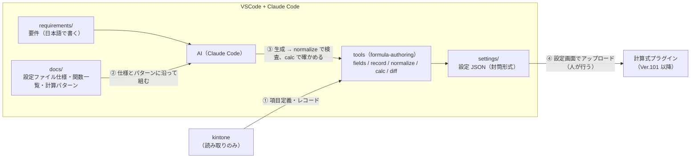

# 計算式プラグイン — AI 設定オーサリング環境

**kintone プラグイン「計算式プラグイン（rex0220 formula）Ver.101 以降」の設定 JSON を、AI（Claude Code + kintone 公式 MCP + tools）に作らせる**ためのテンプレートです。

要件を文章で伝えると、AI が**実アプリの項目定義とレコードを確かめながら**計算式を組み、設定画面でアップロードできる設定 JSON を `settings/` に生成します。tools が設定画面と同じ手順で検査し（`normalize`）、取得したレコードに設定を当てた結果を見せます（`calc`。模擬で、レコードは更新しません）。設定は git で履歴管理できます。



AI に頼めること:

- **新しい設定を作る**（要件 → 仕様の確認 → 計算式 → `normalize` → `calc` → 反映方法）
- **既存の設定を変える**（`pull` かダウンロードしたファイルを写して直し、`diff` で差を見せる）
- **要件を一緒に作る**（短い希望から、項目とレコードを見て質問し、`requirements/` に要件を書く）
- **計算式を解説する**（AI が作ったものも、設定画面からダウンロードした既存の設定の計算式も。何をどの順に計算するか、空や未選択のときの値、注意する点）
- **テストデータを作る**（利用者が「アプリの再利用」で複製したテスト用アプリに、典型でない値を含むテストデータを入れる。承認が出る）
- **新しいアプリを要件から作る**（複製元が無いとき。項目・レイアウト・運用環境への反映・テストデータ。操作ごとに承認が出る。既存のアプリは変えない。計算式プラグインの追加は利用者が設定画面で行う）

**設定を作る・変える作業では、tools も AI も kintone に書き込みません。** 反映は利用者がプラグインの設定画面で行います。例外は、利用者が明示して承認した**テストデータの追加**と**新しいアプリの作成**だけです（下の「推奨」と「セキュリティ」。tools 自体は常に GET だけ）。保存しても**既存のレコードは変わりません**（以後に追加・編集するレコードから計算。既存のレコードは設定画面の「既存レコードを変更」か一覧の「一括計算」で）。

覚えなくてよい用語（出てきたときに見る）:

| 語 | 意味 |
| --- | --- |
| tools | ターミナルで動く道具（`npx @rex0220/formula-authoring-tools …`）。AI が使う。kintone から読むだけ |
| kintone MCP | AI が kintone を見るための公式の仕組み（`@kintone/mcp-server`）。読み取りのツールだけ許可 |
| normalize | 設定ファイルの検査（設定画面と同じ規則）と、既定値を補った形への書き出し |
| calc | 取得したレコードに設定を当てた試算。レコードは更新しない |
| 封筒形式 | 設定画面のダウンロードと同じ形（日付・プラグイン名・版・アプリ番号 + 設定本体） |
| profile | 接続のファイル（複数のドメイン・アプリを使うとき）の接続先の名前 |

## 前提

- Node.js 20 以上
- VSCode + [Claude Code](https://claude.com/claude-code)（サブスクリプションが必要）
- kintone のログインユーザー（パスワード認証。**2 要素認証なし**のアカウント。閲覧専用のアカウントがあればベスト）。運用では対象アプリの**レコード閲覧**権限だけの API トークンも使えます（下の 3）
- 計算式プラグイン Ver.101 以降が対象アプリに入っていること。**その zip ファイル（`formula-plugin101.zip` など、アプリに入れたものと同じ版）を手元に置く**。tools は計算式エンジンと計算式プラグインのコードをこの zip から読みます（tools 自体には含まれません。無ければ配布元から取り直してください）

## セットアップ（7 ステップ）

1. **リポジトリを作る** — このページ右上の **Use this template → Create a new repository** → 自分のアカウントに **private** で作成 → clone
   （設定 JSON にはアプリ番号・項目コード・業務用語が、`records/` `users/` にはレコードの値や個人情報が入ります。**public にしないでください**。作成画面の visibility は **Public が初期値**なので必ず Private に切り替えます）

   [GitHub CLI](https://cli.github.com/) があれば 1 行で:
   ```
   gh repo create formula-settings --template rex0220/formula-authoring --private --clone
   ```
   clone したフォルダー（例 `formula-settings`）を VSCode で開き、以後のコマンドはそのフォルダーのターミナルで実行します（Windows は PowerShell、Mac はターミナル。どちらでも同じコマンドです）
2. **依存を入れる**
   ```
   npm ci
   ```
   tools（`@rex0220/formula-authoring-tools`）と kintone 公式 MCP サーバー（`@kintone/mcp-server`）が入ります。
3. **認証情報を置く** — `.env.example` をコピーして `.env` を作り（Windows の PowerShell: `Copy-Item .env.example .env`、Mac: `cp .env.example .env`）、接続先と計算式プラグインの zip の場所を書きます（`.env` は必ず作ります。kintone MCP は `.env` を読んで起動します）:
   ```
   KINTONE_BASE_URL=https://<自分の環境>.cybozu.com
   FORMULA_PLUGIN_ZIP="C:\Users\you\Downloads\formula-plugin101.zip"
   ```
   Windows の zip の場所は、エクスプローラーで zip を右クリック →「パスのコピー」で貼り付けた形（`"…"` 付き、`\` 区切り）のままでかまいません。Mac は `FORMULA_PLUGIN_ZIP="/Users/you/Downloads/formula-plugin101.zip"` のように書きます。
   ログイン名・パスワードは **OS のユーザー環境変数**に置くのがおすすめです（プロジェクト内のファイルに残りません）。Windows ならコマンドプロンプトで:
   ```
   setx KINTONE_USERNAME "<ログイン名>"
   setx KINTONE_PASSWORD "<パスワード>"
   ```
   を実行して、**VSCode のウィンドウをすべて閉じて起動し直します**（「Reload Window」では反映されません）。
   - 手早く試すだけなら、`.env` の `KINTONE_USERNAME` / `KINTONE_PASSWORD` の 2 行のコメントを外して書いても動きます（`.env` は git 管理外）。OS の環境変数と両方にあれば OS の環境変数が優先です
   - 2 要素認証が有効なアカウントは使えません
   - **運用での推奨は、対象アプリのレコード閲覧だけの API トークン**です（サーバー側でも書き込めなくなります）。ユーザーとパスワードの代わりに `KINTONE_API_TOKEN=<トークン>` を書きます。API トークンは**アプリ単位**です: アプリの設定 → カスタマイズ/サービス連携 → API トークン → 生成 → アクセス権は**「レコード閲覧」のみ** → 保存 → **アプリを更新**。複数アプリはカンマ区切り（最大 9 個）
   - **トークンとユーザーの両方は書かない**（MCP はユーザーを、tools はトークンを使うので食い違います）
   - 閲覧だけの API トークンの運用では、テストデータの追加と新しいアプリの作成（kintone MCP の書き込み）はできません。使うときだけ、レコード追加・アプリ作成の権限のあるログインユーザー（`KINTONE_USERNAME` / `KINTONE_PASSWORD`）にしてトークンを外し、Claude Code を始め直します。終わったら戻します
   - ユーザー情報（UINFO / OUSERS などの関数）を実データで確かめる `users --pull` は、cybozu.com 共通管理の API トークン（`FORMULA_USER_API_TOKEN`）かログインユーザーで呼びます（アプリの API トークンでは呼べません）。要るときだけ
4. **VSCode で開いて Claude Code を起動** — 手順 2・3 の**後に**起動します（kintone MCP は `node_modules` と `.env` を使って起動します。先に起動したならセッションを始め直す）。Claude Code の `/mcp` で、Project の欄に `kintone` が **Connected** と出れば MCP は使えます（登録内容は `.mcp.json`）。kintone の読み取りや `npx @rex0220/formula-authoring-tools` の実行で確認が出たら、**「2 Yes, allow … for this session」**を選ぶと、そのセッションの間は同じ操作で聞かれません。kintone への**書き込みツールは拒否**しています（同梱の `.claude/settings.json`。拒否の規則はいつでも効きます）
   - 毎回の確認を無くしたいときは、下の「補足: 確認を出さないようにする」（任意）
5. **疎通確認** — ターミナルで `npx @rex0220/formula-authoring-tools version`（tools の版と、zip から読んだ計算式プラグインの版・authoring API の版・計算式エンジンの SHA-256 が出る。zip が読めない・版が合わないとここで止まる）。「Need to install the following packages」と聞かれたら、手順 2 の `npm ci` をしていません（`n` で止めて `npm ci` をしてから実行し直す）。Claude Code に「kintone-get-app でアプリ 2305 を見て」（番号は自分のアプリ）と頼んでアプリ名が返れば準備完了です
6. **作る** — `requirements/` に要件を書くか（例: [requirements/example.md](requirements/example.md)）、そのままチャットで伝えます:
   ```
   アプリ 2305（テーブル内集計）で、テーブルの明細の金額（数量 × 単価）と小計の行の金額、テーブルの外の金額合計を計算して
   ```
   AI が `fields/<番号>.json` とレコードを取り、**計算式を書く前にあいまいな点を表にして確かめ**（該当の無い分類の行を出すか、行の順、空のときの値 …）、`normalize` で検査して `settings/APP<番号>-<アプリ名>.json`（封筒形式）に保存し、`calc` で取得したレコードに当てた結果（項目ごとの前後）を見せます。結果は模擬で、レコードは更新しません
   - **アプリはできるだけ番号で指定**してください（番号はアプリの URL `/k/番号/` に出ています）
   - 計算式には項目のラベルでなく**フィールドコード**が入ります。AI は要件のラベルをどのコードに対応させたかを示します
   - **要件そのものを AI と一緒に作ることもできます。** やりたいことが 2〜3 行しか決まっていなければ、そのまま伝えてください（例: 「アプリ 4328 の旅費明細を分類ごとに集計したい」）。AI がアプリの項目とレコードを見て、決めるべき点（該当の無い分類の行を出すか、行の順、空のときの値、テストデータに無い値の扱い …）を質問し、答えをもとに `requirements/<アプリ名>.md` に要件を書きます。それを読んで直してから、設定を作らせてください（要件がファイルに残るので、後で直すときや本番に反映するときの説明にも使えます）
   - **計算式の解説も頼めます。** AI が作った計算式も、設定画面からダウンロードした既存の設定の計算式も（ファイルを `settings/` に置くか `pull` で取り）、「`settings/<ファイル>.json` の 金額 の計算式を解説して」のように頼むと、何をどの順に計算するか（テーブルの行ごとか、ランクと計算順）、空や未選択のときの値、注意する点（副作用のある関数、イベントで変わる、再計算のたびに変わる）を説明します。必要なら `calc` でレコードに当てた実際の値を添えます。関数の使い方や式の断片は、tools に同梱のサンプルアプリで `try` を使って実際の計算式エンジンで確かめてから答えます（利用者のアプリ・レコードは使いません）
7. **反映する** — アプリの設定 → プラグイン → 計算式プラグインの設定 → **設定をアップロード** → `settings/` のファイルを選ぶ → **取り込み方**（設定がまだ無いアプリは「全置換」、既存の設定に項目を足す・変えるときは「項目の置換」で対象の項目をチェック。共通の設定は「共通の設定」のチェックで取り込むかを選ぶ）→ **保存する**（「運用環境に反映」をチェックするとアプリの更新まで行う）→ 以後に追加・編集するレコードは新しい設定で計算されます。**既存のレコードは変わらない**ので、必要なら設定画面の「既存レコードを変更」か一覧の「一括計算」を実行します。ファイルの検証に失敗した場合、既存の設定は変わりません

### 補足: 確認を出さないようにする（任意。主に Windows）

同梱の `.claude/settings.json` の**許可**（kintone の読み取りツール、`npx @rex0220/formula-authoring-tools`、`settings/` などへの保存）は、Claude Code でそのフォルダーを**信頼**したときだけ効きます。Mac では Claude Code の最初の確認で信頼すれば足ります。Windows の VSCode では、VSCode のターミナルで次のとおりにします:

```
cmd
cd /d c:\Users\you\Projects\formula-settings
claude
```

`cd /d` のパスは**ドライブ文字を小文字の `c:`** で打ちます。英語の確認が 2 つ出ます。1 つ目（このフォルダーを信頼するか）は**上下キーで Yes に移って** Enter（既定は No）、2 つ目（`.mcp.json` の kintone サーバーを使うか）も**使う**ほうを選びます。`/exit` で終え、`exit` で cmd を抜けます。その後に始めた VSCode のセッションから効きます（VSCode は Windows でフォルダーを `c:\…`（小文字）で扱い、PowerShell は `C:\…` に直すため、PowerShell から信頼しても VSCode では効きません）。

### 推奨: テスト用アプリとテストデータで作る

本番のアプリと本番のレコードで直接作らず、**テスト用アプリ**（本番のアプリの複製か、同じ項目のアプリ）と**テストデータ**で作って確かめ、できた設定ファイルを本番のアプリにアップロードすることを勧めます。

- テスト用アプリは、kintone の **アプリを作成 → ほかのアプリを再利用** で本番のアプリから作ります（項目、ルックアップ、関連レコード一覧、一覧、プラグインの設定まで写ります。「データも複製」は選ばない）。本番と同じフィールドコードになるので、設定ファイルをそのまま本番にアップロードできます。計算式プラグインが写っていなければ、アプリの設定 → プラグインで追加します
- **テストデータは AI に作らせられます**（「アプリ 4330（テスト用）にテストデータを入れて」。AI が `kintone-add-records` で入れます。承認が出るので、アプリ番号がテスト用アプリであることを確かめてください）。本番のレコードは写しません
- 複製元の無い**新しいアプリ**は、AI に要件から作らせられます（「出張管理のアプリを新しく作って」。アプリの作成 → 項目 → レイアウト → 運用環境に反映 → テストデータ。操作ごとに承認が出ます。計算式プラグインは利用者が追加します）
- テストデータは、要件の典型（テーブルが複数行、小計の行がある …）に加えて、**起こりうるが典型でない値**（選択肢の未選択、空の金額、同じ値の重複、該当なし、0 件）を含むレコードを数件入れる。`calc` はこのレコードで確かめる（本番のレコード = 個人情報を `records/` に置かずに済む）
- 確かめたら、**同じ設定ファイルを本番のアプリの設定画面でアップロード**する（取り込み方は「項目の置換」で変えた項目だけ。「別のアプリの設定です」の注意は出るが取り込める。項目が合わなければ保存のときに止まる）。一覧別設定の一覧 ID はアプリごとに違うので、本番の設定画面で選び直す
- テスト用アプリと本番のアプリを別のドメインや別の番号で持つときは、下の「複数のドメイン・アプリ（接続のファイル）」の profile（dev / prod）で分ける
- 本番に反映した後も、既存のレコードは「既存レコードを変更」か「一括計算」を実行するまで変わらない

## 複数のドメイン・アプリ（任意。接続のファイル）

開発用の環境（ドメイン）や開発用のアプリ、いくつかのアプリを使うときは、kintone の**接続のファイル**（kSQL の `ksql.config.json` と同じ形）を使います。無ければ `.env` の 1 接続の形（`settings/` `fields/` `records/`）のままです。

1. `kintone-connections.example.json` を写して、**作業フォルダーの外**に接続のファイルを作ります（例 `~/kintone-connections.json`）。kSQL を使っていれば、その `ksql.config.json` をそのまま使えます
   - `profiles` に接続先を名前（英数字と `-` `_`）で並べ、`baseUrl`（`https://<サブドメイン>.cybozu.com`）と認証を書きます。認証は、アプリごとの API トークン（`tokenMap` の `APP<番号>`。値は `env:<環境変数の名前>` か、トークンそのもの）か、ログイン名とパスワード（`username` と、`passwordEnv` か `password`）。ゲストスペースは `guestSpaceId`（1 つの profile は 1 つのスペース）
   - `users --pull`（User API）は、profile の `userApiToken`（cybozu.com 共通管理の API トークン。`env:<環境変数の名前>` か値。計算式の tools だけが読むキーで、kSQL は無視します）か、ログイン名とパスワードを使います。アプリの API トークンでは呼べません
   - `defaultProfile` に、ふだん使う profile を書きます（無ければ `dev`。kSQL と同じ）
   - **レコード閲覧だけの API トークン**を勧めます。トークンをファイルに直接書くときは、ほかの利用者に読めないようにします（`chmod 600`）
2. 作業フォルダーの `.env` に `FORMULA_KINTONE_CONFIG=<接続のファイルのパス>` を書きます（絶対パスか、`.env` のフォルダーからの相対パス）。OS の環境変数に置くときは絶対パスにします
3. 設定画面でダウンロードしたファイル（`rex0220-formula-app<番号>-<日時>.json`）は**名前を変えずに** `inbox/` に置きます。`npx @rex0220/formula-authoring-tools take` がアプリのフォルダーへ移します

```
kintone/
  dev/101-出張管理/      fields.json、records/、ダウンロード / pull（名前のまま）、…-edit.json（直したもの）、AI が作った設定、.formula-app.json（印）
  prod/3740-出張管理/
```

4. 作るのも直すのも開発のアプリ。開発のアプリにアップロードして確かめたら、**同じファイルを本番のアプリの設定画面でアップロード**します（取り込み方は「項目の置換」で変えた項目だけ。「別のアプリの設定です」の注意が出ますが取り込めます。項目が合わなければ保存のときに止まります）。**一覧 ID はアプリごとに違う**ので、一覧別設定は本番の設定画面で選び直します

コマンドは `--profile <名前>` で接続先を選びます（省略は `defaultProfile`）。`--app` は番号です。`--guest` と `--out` は使いません（ゲストスペースは profile、保存先はアプリのフォルダー）。`normalize` / `calc` にアプリのフォルダーの中のファイルを渡すと `--fields` は同じフォルダーの `fields.json`、`calc --id 3` は `records/3.json` です。ダウンロード / pull のファイルは書き換えません（`edit` で `-edit.json` に写して直す）。

## 設定ファイルの管理ルール（settings/）

- **固定名で上書き保存**し（`APP<番号>-<アプリ名>.json`。1 アプリ 1 ファイルが正本）、履歴は git の diff で追う
- 既存の設定を変えるときは、`pull` かダウンロードした原本は書き換えず、写し（`…-edit.json`）を直す。反映したら、次の `pull`（またはダウンロード）で固定名のファイルを更新し、写しは消してよい
- **git が正** — 設定画面で直したら、ダウンロードして `settings/` へ戻し、`npx @rex0220/formula-authoring-tools normalize <ファイル> --check` で派生値が一致することを確かめてコミットする
- 常に**封筒形式**（`date` / `pluginName` / `pluginID` / `PluginVersion` / `appId` / `appName` + 設定本体）。`pluginID` は `"rex0220 formula plugin"`
- 反映の前に `npx @rex0220/formula-authoring-tools diff <前> <後>` で差分（★ = 既存のレコードの値に影響する項目）を見る
- `records/` と `users/` はレコードの値・個人情報を含みます。コミットしません（`.gitignore` 済み）。作業が終わったら消してよい

## tools のコマンド

初めて使うときに要るのは `version`、`fields`、`record`、`normalize`、`calc` の 5 つです（AI が使います）。残りは既存の設定・複数の接続・ユーザー情報のためのものです。

| コマンド | 内容 |
| --- | --- |
| `npx @rex0220/formula-authoring-tools version` | tools の版と、zip から読んだプラグインの版・authoring API の版・エンジンの SHA-256、kintone の接続の形 |
| `… fields --app N [--preview]` / `--summary` | 項目定義・レイアウト・一覧を `fields/N.json` に / 1 項目 1 行（○ = 計算式を設定できる型。テーブルの子は左から右） |
| `… record --app N --id R [--fields-from <設定>]` / `--summary` | 1 レコードを `records/N-R.json` に（値を含む。0o600） / 形だけ |
| `… normalize <設定> [--fields f] [--users f] [--out f] [--check]` | 設定画面と同じ手順で検査し、既定値を補った設定を書き出す。`--check` は入力との差 |
| `… calc <設定> --app N --id R [--records R1,R2] [--event …] [--user …] [--users f] [--mobile] [--click <項目コード>]` | 取得済みのレコードに設定を当てた模擬（項目ごとの前後。テーブルは行ごと。更新しない）。評価は Worker で動き、既定 60 秒で止まる。`--click` はボタン（BUTTON / DIALOG）の行を押した模擬（押す前の表示と、押した後に変わる項目） |
| `… try "<式>" [--as 型 \| 項目コード] [--table テーブル1] [--records 1,2,3] [--fields '…'] [--data '…'] [--app N] [--click]` / `--describe` | tools に同梱のサンプルアプリ（全項目タイプ × 2、テーブル 2 つ、レコード 3 件 = 典型 / 端 / 空）で式を試す（関数の使い方や式の断片の確認。利用者のアプリ・レコードは使わない）。`--fields` で項目を足す、`--data` で架空の値のレコード、`--app` で利用者のアプリの項目定義に架空の値 / サンプルアプリの項目の一覧 |
| `… records --app N [--query …]` | レコードを数件、形だけ（代表の 1 件を選ぶため） |
| `… pull --app N [--preview]` | アプリに入っている今の設定を、設定画面のダウンロードと同じ形で `settings/` に（kintone の API ラボの機能が有効な環境） |
| `… summary <設定> [--field <code>]` | 設定の要約（項目数、各種設定、ボタン、一覧、権限、ランク順の計算式） / 1 項目の計算式の全文 |
| `… diff <before> <after>` | 項目単位の差（★ = 既存レコードの値に影響） |
| `… users --summary` / `… users --pull [--only-referenced <設定>]` | ユーザー情報のテストデータの要約 / User API から取る（個人情報。cybozu.com 共通管理の API トークンかパスワード認証）。`--only-referenced` は設定の式が文字列で参照するコードとその所属だけ |
| `… take [--profile <名前>]` | `inbox/` の設定のダウンロードを、アプリのフォルダーへ名前のまま移す（接続のファイルがあるとき） |
| `… edit --app N` | 今の設定（一番新しいダウンロード / pull）を `…-edit.json` に写す。直すのはこちら（接続のファイルがあるとき） |
| `… files --app N` | アプリのフォルダーのファイル（今の設定、直したもの、その他の設定、records）（接続のファイルがあるとき） |

## Claude Code のプラグイン `formula` / Claude Desktop の拡張機能（任意）

[formula MCP](https://github.com/rex0220/formula-authoring-mcp) を入れると、AI は tools の CLI の代わりに、プラグインのツール（`fml_docs` の手順、`fml_save_settings` / `fml_update_fields` の保存、`fml_calc` の模擬の計算、kintone からの読み取り）で同じ作業をします。このフォルダーと、`settings/`・`kintone/` の置き場所はそのまま使えます。Claude Desktop（kintone MCP も Claude Code も無い）でも、同じ拡張機能（`.mcpb`）で設定を作れます。

- **Claude Code**: ターミナルの `claude` で `/plugin install formula --marketplace rex0220/formula-authoring-mcp`（Claude Code 2.1.275 以降）。設定は `/plugin configure formula@rex0220-formula`（か `/config`）で、計算式プラグインの zip（空ならこのフォルダーの `.env` の `FORMULA_PLUGIN_ZIP`）と計算式プラグインの接続のファイル（kintone）（kSQL の `ksql.config.json` の形の絶対パス。`.env` ではない。プラグインは `.env` の 1 接続の形を読まないので、kintone を使うには接続のファイルが要ります）。作業フォルダーは、初めてツールを使うときに確認が出て登録されます（登録の後は `/mcp` で formula を再接続）
- **Claude Desktop**: [リリース](https://github.com/rex0220/formula-authoring-mcp/releases/latest) の `formula-authoring-<版>.mcpb` を入れ、設定で作業フォルダー（このフォルダー）、計算式プラグインの zip、接続のファイルを選びます。テスト用アプリとテストデータの作成（kintone MCP の書き込み）は Desktop ではできないので、利用者が作ります
- プラグインは中核（tools）を束ねているので、このフォルダーの tools（npm）とは別に版が上がります。計算式プラグインの zip は同じものを使います
- 使わないときは `/plugin` の Installed で無効にします。AI は [docs/AI作業手順.md](docs/AI作業手順.md) の CLI の手順に戻ります。詳しくは [docs/バージョンアップ手順.md](docs/バージョンアップ手順.md) の 5 章

## テンプレートの更新を取り込む

計算式プラグインの新しい版に合わせて、このテンプレートの docs/ と tools の版は更新されます。**フォルダーを作り直す必要はありません。** 計算式プラグインを上げただけなら、ふつうは `.env` の zip を入れ替えるだけです。zip の入れ替え、tools だけを上げる方法、Claude Code に頼む方法、作り直すときに写すもの、つまずいたときは [docs/バージョンアップ手順.md](docs/バージョンアップ手順.md) にあります。

テンプレートのファイルを取り込むときは、テンプレートのファイルだけを最新に置き換えます:

```
git remote add template https://github.com/rex0220/formula-authoring.git   # 初回のみ
git fetch template
git checkout template/main -- .claude .mcp.json .env.example .gitignore CLAUDE.md README.md LICENSE kintone-connections.example.json package.json package-lock.json docs samples settings/README.md requirements/example.md policy/README.md
npm ci
npx @rex0220/formula-authoring-tools version
git commit -m "テンプレートの更新を取り込む"
```

- 置き換えるのはテンプレートのファイルだけです。自分の `settings/` `requirements/` `fields/` `kintone/` `policy/authoring-policy.json` と `.env` には触れません
- テンプレートのファイルを自分で直していた場合、その変更は消えます。Claude Code の許可を足すなら `.claude/settings.local.json`、git で無視するファイルを足すなら `.git/info/exclude` に書いてください
- `git merge template/main --allow-unrelated-histories` では取り込まないでください（テンプレートから作ったリポジトリはテンプレートと履歴がつながっていません）
- tools の版は計算式プラグインの版とは別です。tools が扱う計算式プラグインの版（Ver.101 以降）と authoring API の版は `version` に出ます。計算式プラグインを上げたら `.env` の zip も入れ替えます。「authoring API の版 … には対応していない」と出たら tools を新しい版にします

## ドキュメント

| ファイル | 内容 |
| :--- | :--- |
| [docs/設定ファイル仕様.md](docs/設定ファイル仕様.md) | 設定 JSON の形式の**正本**（封筒、キー、既定値、書かないキー。zip から機械生成） |
| [docs/使い方ナビ.md](docs/使い方ナビ.md) | できること（計算の種類と記事）、使い方の流れ、頼み方の例、今の計算式の変え方、AI がしないこと。QA（問題と答え）の頼み方 |
| [docs/関数一覧.md](docs/関数一覧.md) | 使える計算式の関数（250 個。引数、説明、印、使用例。zip から機械生成） |
| [docs/計算パターン.md](docs/計算パターン.md) | 定型の計算のやり方（やりたいこと → やり方 → 式の例 → 確かめること → 記事） |
| [docs/既定のテストデータ.md](docs/既定のテストデータ.md) | `calc` が UINFO などに使う架空のユーザー情報（10 人） |
| [docs/バージョンアップ手順.md](docs/バージョンアップ手順.md) | 計算式プラグイン・tools・テンプレートを新しい版にする手順（作り直さなくてよい） |
| [samples/](samples/) | 雛形（`settings-source.json`）と項目定義の例 |
| [CLAUDE.md](CLAUDE.md) | AI への常設指示（常に守ることと、どの手順で作業するか。このリポジトリを開いた Claude Code が自動で読みます） |
| [docs/AI作業手順.md](docs/AI作業手順.md) | AI の作業手順（読む文書、要約コマンド、仕様の確認、新規と変更の流れ、normalize の規則名と直し方、計算式の制約、反映の 4 段） |
| [policy/README.md](policy/README.md) | 副作用のある関数と各種設定の変更の承認（利用者が書く。既定は BUTTON / DIALOG / FSET / FSET_TADD を承認） |

## トラブルシュート

| 症状 | 確認すること |
| :--- | :--- |
| MCP サーバーが起動しない | Node.js 20 以上か（`node -v`）。`npm ci` 済みか。`.env` を作ったか |
| `/mcp` に `kintone` が出ない、AI が kintone のツールが無いと言う | `npm ci` と `.env` の前にセッションを始めた → 始め直す。それでも出ないなら `.claude/settings.local.json` に `"disabledMcpjsonServers": ["kintone"]` がある → そこから `kintone` を消して始め直す |
| `npx @rex0220/formula-authoring-tools` で `Need to install the following packages` と出る | このフォルダーで `npm ci` をしていない。`n` で止め、`npm ci` してから実行する |
| 毎回確認が出る | 手順 4 の補足（フォルダーの信頼）をしていない。するまでは「2 Yes, allow … for this session」を選ぶ |
| `KINTONE_BASE_URL が無い` | `.env` の場所（リポジトリのルート）と変数名。OS の環境変数を設定したなら VSCode を完全に再起動 |
| `計算式プラグインの zip が無い` / `版 … には対応していない` | `.env` の `FORMULA_PLUGIN_ZIP` のパス。zip の版が Ver.101 以上か（Ver.100 以前の zip には authoring API が無い）。`authoring API の版 … には対応していない` なら tools を新しい版にする |
| `計算式プラグインの zip ではない（プラグイン ID …）` | `FORMULA_PLUGIN_ZIP` が計算式プラグインの zip か（別のプラグインの zip でないか）。配布元から取り直す |
| `KINTONE_BASE_URL が不正` / `kintone のドメインではない` | `https://<サブドメイン>.cybozu.com` の形だけ（`.kintone.com` / `.cybozu.cn` も可）。パス・ポート・`@` を付けない |
| `書き込み先は … の下` / `作業フォルダーの中` | tools が書くのは `fields/` `records/` `settings/` `temp/` `users/` `kintone/` の下だけ |
| `HTTP 401` / `403` | ログイン名とパスワード。2 要素認証が無効なアカウントか。そのユーザーにアプリの閲覧権限があるか。API トークンなら、トークンのアプリと権限（レコード閲覧）、トークン生成後に**アプリを更新**したか |
| `pull` が `HTTP 4xx` | kintone の API ラボ「アプリに追加されているプラグインの設定情報を取得または更新するREST API」が有効か（cybozu.com 共通管理者がアップデートオプションで）。`--preview` はアプリ管理の権限が要る |
| `User API … は kintone アプリの API トークンでは呼べない` | `users --pull` は `FORMULA_USER_API_TOKEN`（cybozu.com 共通管理の API トークン）か、`KINTONE_USERNAME` / `KINTONE_PASSWORD` で |
| `ログインユーザーを使う項目 … があるが、ユーザーが決まらない` | `calc --user <コード>` を付ける（引数なしの `UINFO()` などはログインユーザーで決まる。`--users` の実データにそのユーザーが要る） |
| `normalize` のエラーが消えない | 文言の末尾の規則名（`formula.syntax`、`field.missing` など）を AI に伝える。規則名の意味と直し方は [docs/AI作業手順.md](docs/AI作業手順.md) の「normalize の結果」 |
| アップロードで「設定ファイルの内容が不正です」 | 封筒形式か、`pluginID` が `"rex0220 formula plugin"` か。`normalize` を通したファイルか |
| 保存したのに既存のレコードの値が変わらない | 仕様です。設定画面の「既存レコードを変更」か一覧の「一括計算」を実行する |
| `calc` の結果と実機の結果が違う | `calc` は「既存レコードを変更」の文脈（イベント allUpdate）で、ユーザー情報は既定の架空のテストデータ、kintone の文脈（ログインユーザー、ルックアップ先）はダミーの値。`--event` / `--user` / `--users` で近づける |

## セキュリティ

- このテンプレートは kintone を**読み取り専用**で使います。書き込みは 3 層で防いでいます:
  ① [CLAUDE.md](CLAUDE.md) で書き込みツールの使用を禁止
  ② `.claude/settings.json` で kintone MCP の書き込みツール（レコード・フォーム・アプリ・スペースの更新 / 削除、ステータスの更新、コメント、ファイルのダウンロード）と、設定に要らない読み取りツール（検索・スペース・レコードのコメント）を**拒否**
  ③ tools は GET しか送らず、呼べる API と送信先（`*.cybozu.com` / `*.kintone.com` / `*.cybozu.cn`）を固定（`npm pack` の中身で確かめられます）
- **例外はテストデータと新しいアプリの作成だけ**です。5 つのツール（`kintone-add-records`、`kintone-add-app`、`kintone-add-form-fields`、`kintone-update-form-layout`、`kintone-deploy-app`）は拒否も許可もしていないので、使うたびに承認の確認が出ます。CLAUDE.md は、テストデータは利用者が告げたテスト用アプリにだけ、新しいアプリの項目・レイアウト・反映は **add-app が返した番号に対してだけ**使うよう AI に指示しています。既存のアプリの複製は AI にさせません（利用者が「アプリの再利用」で）。`add-form-fields` などは既存のアプリにも使えるツールなので、**承認の画面でアプリ番号を確かめてください**。使わない運用なら、この 5 つを `.claude/settings.json` の `deny` に戻せば完全に読み取り専用になります
- ログインユーザーで使うときは、そのユーザーが見られるアプリとレコードを AI も見られます。サーバー側からも担保したい場合は、**閲覧権限だけのアカウント**か、**レコード閲覧だけの API トークン**（運用での推奨）を使ってください
- 認証情報は OS の環境変数、`.env`（コミット対象外）、作業フォルダーの外の接続のファイルのどれかに置き、リポジトリに入れない。AI は `.env` を読まず（`.claude/settings.json` の `Read(.env)` の拒否）、`.env` と `policy/` を編集しません。tools が読む `.env` と `policy/authoring-policy.json` と計算式プラグインの zip の場所はこのフォルダーのものに固定で、AI がオプションで別のファイルを指定することはできません
- tools は、`FORMULA_PLUGIN_ZIP` の zip のプラグイン ID（zip の公開鍵から）が計算式プラグインのものでなければ、中のコードを**実行せずに止まります**。署名は確かめないので、中身を差し替えた zip は見分けられません。zip の中のコードはこの PC の権限で動くので、配布元から入手した zip だけを使ってください
- `calc` は計算式を実際に評価します（計算式エンジンは利用者の zip のもの）。kintone への書き込み・クリップボード・画面の操作に当たる関数（FSET / FSET_TADD / BUTTON / DIALOG / CLIPBORD_WRITE）は、利用者が `policy/authoring-policy.json` で承認したものだけ評価し（テンプレートの既定はボタンの中で使う BUTTON / DIALOG / FSET / FSET_TADD。評価は写しのレコードの上で kintone には書きません。CLIPBORD_WRITE は未承認）、評価中にクリップボードや kintone API が呼ばれた結果は採りません。評価は Worker で動かし、時間の上限（既定 60 秒）で止めます
- `records/` と `users/` にはレコードの値・個人情報が入ります（macOS / Linux では本人だけが読める権限で書きます。Windows はユーザーフォルダーの権限に依るので、共有フォルダーに置かないでください）。`.claude/settings.json` は Claude Code の直接の Read を拒否し、AI は要約コマンドで形だけを見ます。ただし、許可した kintone MCP の取得結果（`kintone-get-records` など）と `calc` の出力（変わる項目の前後の値）は AI が読み、Claude の処理に使われます（git に入らないことと、AI に渡らないことは別です）。Bash で開くことは CLAUDE.md で禁じていますが技術的な遮断ではないので、確認が出たら利用者が拒否してください。作業が終わったら消し、リポジトリは private に。実データを使えない場合は、テスト用のアプリとサンプルのデータで試してください（上の「推奨」）
- 脆弱性の報告先と、tools が守ること・利用者が守ることの一覧は [tools/SECURITY.md](tools/SECURITY.md)

## ライセンス

- このリポジトリ（テンプレート、文書、tools のソース）と npm パッケージ `@rex0220/formula-authoring-tools` は MIT License
- 計算式プラグインの zip の中身（計算式エンジン、設定画面のコード、authoring API）は計算式プラグインの利用規約に従います。tools はそれらを含まず、利用者の zip から実行時に読むだけです
- 同梱・依存する第三者のソフトウェア（moment、happy-dom）は `tools/THIRD_PARTY_NOTICES.md`
