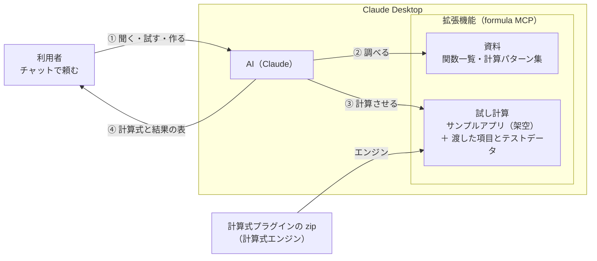

<!--
title: rex0220 計算式プラグイン - AI(Claude Desktop)に計算式を聞く・作らせる 実践編
tags:
  - kintone
  - Claude
  - MCP
private: false
url: https://qiita.com/rex0220/items/dca414a52918fa102c01（2026-10-19 公開。Qiita に貼るときは、このコメントを除く）
-->

[前回の記事](https://qiita.com/rex0220/items/36b77265b178baf754ef)では、Claude Desktop の拡張機能「計算式 設定オーサリング（Formula）」で、kintone のアプリの計算式の設定を AI に作らせました。

今回は **kintone のアプリを使わずに**、チャットだけで計算式プラグインの関数を聞き、式を試し、要件とテストデータから計算式を作らせます。アプリを作る前に式の組み立てを考えたいとき、関数の使い方を知りたいときに向いています。

```
計算式プラグインで、次の要件とテストデータで計算式を作って。
kintone のアプリはまだ無いので、試し計算で確かめて。
（項目、要件、テストデータを続けて書く）
```

AI は、拡張機能に同梱のサンプルアプリ（架空の項目と値）に、渡した項目とテストデータを足し、**計算式プラグインの計算式エンジンで実際に計算して**から、項目ごとの計算式と結果の表を返します。

# 仕組み



- **①** チャットで、関数を聞く・式を試す・要件とテストデータを渡して作る、のどれかを頼みます
- **②** AI は拡張機能に入っている資料（関数一覧・計算パターン集）で、関数と書き方を調べます
- **③** 式は、同梱のサンプルアプリに渡した項目とテストデータを足して、手元の計算式プラグインの zip の計算式エンジンで実際に計算します
- **④** 確かめた計算式と結果の表を返します。kintone には何も送らず、アプリもレコードも使いません

---

# 前提

- Claude Desktop に拡張機能を入れてあること（[前回の記事の「準備」](https://qiita.com/rex0220/items/36b77265b178baf754ef)）。拡張機能は 0.3.6 以降、計算式プラグインの zip は Ver.101 以降
- この記事の使い方では、**kintone の接続のファイルは無くても動きます**（アプリもレコードも使いません）


# 頼み方は 3 つの型

| 型 | 頼む文の例 | AI がすること |
| :--- | :--- | :--- |
| **聞く** | 計算式プラグインの DATE_DIFF 関数の使い方を教えて | 拡張機能に入っている資料（関数一覧・計算パターン集）で答える |
| **試す** | 計算式プラグインで、ROUND(-2.5, 0) と ROUNDDOWN(-2.5, 0) を試して | 同梱のサンプルアプリで、計算式エンジンに実際に計算させて結果を返す |
| **作る** | 計算式プラグインで、次の要件とテストデータで計算式を作って | 渡した項目と値をサンプルアプリに足して試し計算し、項目ごとの計算式と結果の表を返す。決まっていない点は聞いてくる |

コツは 3 つです。

- **「計算式プラグインで」と付けて**頼む（拡張機能の道具を使ってほしい、という合図）
- 項目は**「コード: 型」**で書く（例 `金額: 数値`、`見積日: 日付`）。テーブルの中の項目は、どのテーブルの子かも書く
- テストデータには、ふつうの値だけでなく**端の値（空、0、未選択、月末、日をまたぐ時刻など）**を入れる。AI がその扱いを確かめ、決まっていなければ聞いてくる

「試す」と頼むと、ツール（Fml try）で計算式エンジンに計算させて、結果を表で返します。


# 関数の使い方を聞く

```
計算式プラグインの DATE_DIFF 関数の使い方を教えて。見積日から納期までの日数を出したい。
```

返答の抜粋です。

> `DATE_DIFF(前の日付, 後の日付, 単位)` で、後 − 前 の差が返ります。見積日から納期までなら次のとおりです。
> ```
> IF(AND(見積日, 納期), DATE_DIFF(見積日, 納期, "days"), "")
> ```
> **押さえどころ**
> - **引数の順番**：（前の日付, 後の日付）です。逆にすると負の数になります。
> - **空の扱い**：空の日付は 1970-01-01 として数えられ、-21166 のような値になります（両方空なら 0）。そのため上の式のように `IF(AND(…))` で空を分けておくのが安全です。
> - **今日との差**：日付の代わりに `"TODAY"` を渡せます。
> - **時刻項目は不可**：時刻（日付なし）の項目を渡すと NaN になります。
>
> 返る値は「差」なので、見積日と納期が同じ日なら 0 です。両端を含めて「○日間」としたい場合は `+ 1` してください。

使い方だけでなく、**空のときにどうなるか**、時刻の項目には使えないことまで添えてきます。ここは拡張機能の資料（ツールの行の「Fml docs」）で答えています。資料に無い端の動きは、AI が試し計算で確かめてから答えます。


# 関数の Q&A（10 問）

よく聞かれる 5 つの分野を 2 問ずつ。式と結果は、どれも計算式プラグインの計算式エンジン（Ver.101）で確かめたものです。

## 条件・空

**Q1. 数量が空のとき、金額を 0 にしたい**

```
NVL(数量, 0) * 単価
```

| 数量 | 単価 | `数量 * 単価` | `NVL(数量, 0) * 単価` |
| :--- | ---: | ---: | ---: |
| （空） | 1000 | （空） | 0 |
| 3 | 1000 | 3000 | 3000 |

空の数値を計算すると、結果も空のままです。0 として計算したいときは `NVL(項目, 0)` で 0 に置き換えます。

**Q2. 数量が空か（未入力か）を見分けたい。0 は入力ありにしたい**

```
IF(ISBLANK(数量), "未入力", "入力あり")
```

| 数量 | `IF(数量 = "", …)` | `IF(ISBLANK(数量), …)` |
| :--- | :--- | :--- |
| （空） | 未入力 | 未入力 |
| 0 | **未入力** | 入力あり |
| 5 | 入力あり | 入力あり |

数値の項目では **0 も `= ""` で真**になります（空も 0 として数で比べるため）。空だけを見分けるときは `ISBLANK` を使います。

## 日付・時刻

**Q3. 有効期限を、見積日の翌月末にしたい**

```
IF(見積日, DATE_ENDOF(DATE_ADD(見積日, 1, "month"), "month"), "")
```

| 見積日 | 有効期限 |
| :--- | :--- |
| 2026-01-31 | 2026-02-28 |
| 2026-12-15 | 2027-01-31 |
| （空） | （空） |

1 か月足してから、その月の末日を取ります。1/31 に 1 か月足すと 2/28 になり、年をまたいでも翌年の 1 月末になります。

**Q4. 勤務時間（分）を出したい。夜勤（日をまたぐ勤務）もある**

```
IF(AND(出勤, 退勤),
  MOD(DURATION_AS(退勤, "minutes") - DURATION_AS(出勤, "minutes") + 1440, 1440) - NVL(休憩, 0),
  "")
```

| 出勤 | 退勤 | 休憩 | 単純な引き算 | 上の式 |
| :--- | :--- | ---: | ---: | ---: |
| 09:30 | 18:15 | 60 | 465 | 465 |
| 22:00 | 06:00 | 60 | **-1020** | 420 |
| 09:00 | （空） | 60 | **-600** | （空） |

`DURATION_AS` で時刻を分にして引き、`MOD(… + 1440, 1440)` で日をまたぐ分を直します。空の時刻は 0 分として計算されるので、`IF(AND(出勤, 退勤), …, "")` で分けます。

## 文字列・選択

**Q5. 郵便番号が「123-4567」の形かを調べたい**

```
IF(郵便番号 = "", "", IF(TESTRE(郵便番号, "^[0-9]{3}-[0-9]{4}$"), "", "郵便番号は 123-4567 の形で"))
```

| 郵便番号 | 結果 |
| :--- | :--- |
| 100-0005 | （空） |
| 1000005 | 郵便番号は 123-4567 の形で |
| （空） | （空） |

`TESTRE` は正規表現で調べて true / false を返します。空も false になるので、空を先に分けます。

**Q6. 担当者（ユーザー選択）の名前を「、」でつないで表示したい**

```
IF(担当者, "担当: " & SEL_NAME(担当者, "text", "、"), "")
```

| 担当者 | `"担当: " & 担当者` | 上の式 |
| :--- | :--- | :--- |
| 2 人 | 担当: 架空 営業一郎, 架空 営業二郎 | 担当: 架空 営業一郎、架空 営業二郎 |
| 1 人 | 担当: 架空 営業一郎 | 担当: 架空 営業一郎 |
| （空） | 担当: | （空） |

ユーザー選択をそのまま文字につなぐと「, 」区切りになります。区切りを決めるときは `SEL_NAME(項目, "text", 区切り)` を使います。

## テーブル

**Q7. 明細のうち、税区分が「課税」の金額だけを合計したい（消費税の計算）**

```
ROUNDDOWN(SUMIF(税区分 = "課税", 金額) * 0.1, 0)
```

| 明細（品名・税区分・金額） | `SUMIF(税区分 = "課税", 金額)` | 消費税 |
| :--- | ---: | ---: |
| ノートPC 課税 316,000 / マウス 課税 7,440 / 保守契約 非課税 30,000 | 323,440 | 32,344 |
| （明細なし） | 0 | 0 |

`SUMIF(条件, 合計する項目)` はテーブルの外の項目に書きます。明細が無いときは 0 です。金額が税抜で、課税の明細がすべて 10% の例です（税率が複数あるときは、税率ごとに `SUMIF` を分けます）。

**Q8. 明細の単価を、単価表（別のテーブル）から品目で引いて入れたい**

```
LET(k, 明細品目, NVL(FIRSTIF(品目 = k, 標準単価), 0))
```

| 単価表（品目・標準単価） | 明細の品目 | 単価 |
| :--- | :--- | ---: |
| A 100 / B 250 / C 1000 | B | 250 |
| | C | 1000 |
| | Z | 0 |

明細の行ごとに、その行の品目を `LET` で変数 `k` に入れ、単価表から同じ品目の最初の行の単価を取ります。単価表に無い品目は `NVL` で 0 にしています。

## 数・金融

**Q9. 端数を切り捨て・四捨五入したい。マイナスのときは？**

| 数値 | `ROUND(数値, 0)` | `ROUNDDOWN(数値, 0)` | `ROUNDUP(数値, 0)` | `INT(数値)` |
| ---: | ---: | ---: | ---: | ---: |
| 2.5 | 3 | 2 | 3 | 2 |
| -2.5 | -3 | -2 | -3 | -3 |
| 199.9 | 200 | 199 | 200 | 199 |
| -199.9 | -200 | -199 | -200 | -200 |

`ROUND` は 0 から遠い方へ（-2.5 → -3）、`ROUNDDOWN` は 0 の方へ（-2.5 → -2）、`INT` は小さい方へ（-2.5 → -3）丸めます。マイナスがあり得る項目では、どれを使うかで結果が変わります。

**Q10. ローンの毎月の返済額（元利均等）を出したい**

```
ROUND(-R_PMT(年利 / 100 / 12, 年数 * 12, 借入額), 0)
```

| 借入額 | 年利（%） | 年数 | `R_PMT(…)` | 上の式 |
| ---: | ---: | ---: | ---: | ---: |
| 1,000,000 | 3 | 3 | -29081.2096… | 29,081 |
| 1,000,000 | 0 | 3 | -27777.7777… | 27,778 |
| （空） | （空） | （空） | （空） | （空） |

`R_` で始まる金融の関数は Excel の同名の関数と同じ考えで、**支払いはマイナス**で返ります（`-` を付けて正の数に）。利率は 1 回分（年利 ÷ 12）を渡します。Excel の `=PMT(3%/12, 36, -1000000)` も 29,081 円です。

貸し手の返済表は、毎月の 1 円未満を切り上げて最終回で調整することがあります（`ROUNDUP`）。四捨五入にするか切り上げにするかは、要件に書いておきます。

# 要件とテストデータを渡して作る

ここまでは関数を 1 つずつ試しました。ここからは、いくつもの項目と計算式を組み合わせて、見積書と勤怠の計算式を作らせます。

## 要件の書き方

3 つに分けて書くと、AI が取り違えません。

```
項目（コード: 型）
- 見積日: 日付、有効期限: 日付
- 明細（テーブル）: 品名: 文字列、単価: 数値、数量: 数値、税区分: ドロップダウン（課税 / 非課税）、金額: 数値
- 小計: 数値、消費税: 数値、合計: 数値

要件
- 金額 = 単価 × 数量
- 小計 = 金額の合計、消費税 = 課税の明細の金額の合計 × 10%、合計 = 小計 + 消費税
- 有効期限 = 見積日の翌月末
```

- **項目**: コードと型。テーブルの中の項目は、どのテーブルの子か。ドロップダウンなどは選択肢も
- **要件**: どの項目に何を出すか。決まっている決まり（端数、空のとき）は書いておく。書いていない点は AI が聞いてくるか、決めた扱いを返答に書いてくる

## テストデータの書き方

表にして書きます。**典型・端・空**の 3 種類を入れるのがコツです。

| 種類 | 例 |
| :--- | :--- |
| 典型 | ふつうの値（明細 3 行、課税と非課税） |
| 端 | 数量が空・0、月末の日付、日をまたぐ時刻、未選択、全角の数字、端数の出る金額 |
| 空 | 日付が空、明細が 0 行 |

1 回に渡せるのは 5 件まで、テーブルは 1 つにつき 20 行までです（拡張機能の試し計算の上限）。

## 実例 1: 見積書

上の要件に、次のテストデータを付けて頼みました。

```
計算式プラグインで、次の要件とテストデータで計算式を作って。kintone のアプリはまだ無いので、試し計算で確かめて。
（項目と要件は上のとおり）

テストデータ
| No | 見積日 | 明細（品名・単価・数量・税区分） |
| 1 | 2026-10-15 | ノートPC 158000 2 課税 / マウス 2480 3 課税 / 保守契約 30000 1 非課税 |
| 2 | 2026-01-31 | ケーブル 333 3 課税 / 設定作業 15000（数量なし）課税 / 送料 1234 1 非課税 |
| 3 | （なし） | （明細なし） |
```

AI の返答（抜粋）です。

> 計算式を作り、サンプルアプリに同じ項目を足して、テストデータ 3 件で試し計算しました。全式ともエラー・警告はありません。
>
> | 項目 | 計算式 |
> | --- | --- |
> | 明細.金額 | `単価 * 数量` |
> | 小計 | `SUM(金額)` |
> | 消費税 | `ROUNDDOWN(SUMIF(税区分 = "課税", 金額) * 0.1, 0)` |
> | 合計 | `小計 + 消費税` |
> | 有効期限 | `DATE_ENDOF(DATE_ADD(見積日, 1, "month"), "month")` |
>
> 計算順は「テーブルの外 → テーブルの中 → テーブルの外（2 回目）」です。このため金額から小計・消費税・合計まで、ランクを付けなくても正しく計算されます。
>
> | No | 金額（行ごと） | 小計 | 消費税 | 合計 | 有効期限 |
> | --- | --- | --- | --- | --- | --- |
> | 1 | 316000 / 7440 / 30000 | 353440 | 32344 | 385784 | 2026-11-30 |
> | 2 | 999 /（空）/ 1234 | 2233 | 99 | 2332 | 2026-02-28 |
> | 3 | （行なし） | 0 | 0 | 0 | （空） |
>
> **決めていただきたい点**
> - **消費税の端数**：No.2 の課税の合計は 999 なので、10% は 99.9 です。今回の式は切り捨て（`ROUNDDOWN`）で 99 にしています。四捨五入にする場合は `ROUND`、切り上げにする場合は `ROUNDUP` に替えてください。
> - **数量が空の行**：No.2 の「設定作業」は数量が空なので、金額も空になり、小計・消費税には入りません。空の行の金額を 0 と表示したい場合は、`NVL(単価, 0) * NVL(数量, 0)` にしてください。こちらも試し計算済みで、空の行は 0 になり、小計は同じ 2233 です。


要件に書いていなかった 2 点（端数と、数量が空の行）を、テストデータの No.2 で見つけて聞いてきました。代わりの式（`NVL(単価, 0) * NVL(数量, 0)`）も、試し計算してから勧めています。「消費税は合計に 10% をかけて切り捨て、数量が空の行は金額も空のまま」と答えると、式を変えずに確定し、お任せにした点（明細が無ければ小計・消費税・合計は 0、見積日が空なら有効期限も空）を書き添えてきました。


試し計算は 1 つの式ごとに計算するので、小計・消費税・合計のように前の式の結果を使う式は、前の式の結果を値として渡して確かめます。返答の「計算順」は、計算式プラグインの決まり（ランクを付けないときの順）で、拡張機能の資料にも書いてあります。式どうしのつながり（計算の順番を含む）は、アプリに設定した後で、テスト用のレコードを入れて確かめてください。

## 実例 2: 勤怠

```
計算式プラグインで、勤怠の計算式を作って。kintone のアプリはまだ無いので、試し計算で確かめて。

項目（コード: 型）: 日付: 日付、曜日: 文字列、出勤: 時刻、退勤: 時刻、休憩: 数値（分）、勤務時間: 数値（分）

要件
- 勤務時間 = 退勤 − 出勤 − 休憩（分）
- 曜日は「月」のように 1 文字で

テストデータ
| 日付 | 出勤 | 退勤 | 休憩 |
| 2026-10-19 | 09:30 | 18:15 | 60 |
| 2026-10-24 | 22:00 | 06:00 | 60 |
| 2026-10-20 | 09:00 | （なし） | 60 |
```

1 回目の返答（抜粋）です。

> 式は 2 つで、テストデータ 3 件とも想定どおりの結果になりました（同梱のサンプルアプリに同じコード・型の項目を足し、架空の値で計算しました。kintone には何も送っていません）。
>
> **曜日**（文字列）
> ```
> IF(日付, ARRAY_GET(ARRAY("日","月","火","水","木","金","土"), DATE_FORMAT(日付, "d") * 1), "")
> ```
> **勤務時間**（数値・分）
> ```
> IF(AND(出勤, 退勤), MOD(DURATION_AS(退勤, "minutes") - DURATION_AS(出勤, "minutes") + 1440, 1440) - 休憩, "")
> ```
>
> | 日付 | 出勤 | 退勤 | 休憩 | 曜日 | 勤務時間 |
> | --- | --- | --- | --- | --- | --- |
> | 2026-10-19 | 09:30 | 18:15 | 60 | 月 | 465 |
> | 2026-10-24 | 22:00 | 06:00 | 60 | 土 | 420 |
> | 2026-10-20 | 09:00 | （なし） | 60 | 火 | （空） |
> | （空） | （空） | （空） | （空） | （空） | （空） |
>
> - **日またぎ**：差に 1440 を足して `MOD(…, 1440)` を取るので、22:00〜06:00 は 480 分 − 休憩 60 分 = 420 分になります。そのかわり、24 時間以上の勤務と、出勤と退勤が同じ時刻（0 分になる）は区別できません。
> - **退勤が空のとき**：`IF(AND(出勤, 退勤), …)` で空にしています。この判定を外した式も比べたところ、空の時刻は 0:00 として扱われ、3 件目が 840 分という誤った値になりました。
> - **休憩が空のとき**：休憩を 0 分として計算します。


テストデータの 2 行目（22:00〜06:00）と 3 行目（退勤が空）から、日をまたぐ勤務と打刻漏れの扱いを自分で決めて、その旨を書いてきました。打刻漏れは、判定を外した式と比べて、誤った値（840 分）になることまで確かめています。全部が空の行も自分で足しています。

ただ、最後の「休憩が空なら 0 分」は、試していない説明でした。「夜勤があるので、日をまたぐ勤務もあります。退勤か出勤が空なら勤務時間は空に、休憩が空なら 0 分として計算してください」と足して頼むと、AI は**まだ試していなかった「休憩だけが空」の行を足して試し、前回の説明の誤りに自分で気づいて**式を直しました。

> 確かめたところ、前回の説明に誤りがありました。前回の式は、休憩が空だと 0 分にはならず、勤務時間が空になります。休憩を `IF(休憩, 休憩, 0)` にした式で、ご指定どおりに動くことを確かめました。

確定した勤務時間の式です。

```
IF(AND(出勤, 退勤),
  MOD(DURATION_AS(退勤, "minutes") - DURATION_AS(出勤, "minutes") + 1440, 1440) - IF(休憩, 休憩, 0),
  "")
```


日をまたぐ分を `MOD` で直す式なので、24 時間以上の勤務は計算できず、出勤と退勤が同じ時刻だと 0 分になります（AI も返答にそう書いてきました）。休憩が勤務より長いときはマイナスのまま出し、0 で止めたいなら `MAX(…, 0)` で囲む、とも書き添えています。

数値の項目が空だと、引き算の結果も空になります（「間違えやすいところ」の「空の数値の計算」）。AI の説明も、試し計算で確かめるまでは推測です。テストデータに端の値（ここでは休憩が空）を入れておくと、こうした食い違いが見つかります。

# 間違えやすいところ

試し計算で確かめると、思い込みと違う動きがいくつかあります。AI もこれを踏まえて式を書きますが、要件を書くときに知っておくと役に立ちます。

| ところ | 動き | 書き方 |
| :--- | :--- | :--- |
| 空と 0 | 数値の 0 も `= ""` で真 | 空だけを見分けるなら `ISBLANK`（Q2） |
| 空の数値の計算 | 結果も空のまま | 0 にするなら `NVL(項目, 0)`（Q1） |
| 空の日付の差 | `DATE_DIFF` は 1970-01-01 として数える | `IF(AND(日付1, 日付2), DATE_DIFF(…), "")` |
| 時刻の差 | 日をまたぐとマイナス、空の時刻は 0 分 | `MOD(… + 1440, 1440)` と `IF(AND(…), …, "")`（Q4） |
| ユーザー選択を文字に | 「, 」区切りになる | `SEL_NAME(項目, "text", 区切り)`（Q6） |
| マイナスの端数 | `ROUNDDOWN` と `INT` で結果が違う | どちらにするかを要件に書く（Q9） |
| 金融の関数 | 支払いはマイナスで返る | `-` を付ける（Q10） |
| 全角の数字 | 正規表現の `[0-9]` に合わない | 先に `ASC(項目)` で半角に |

# まとめ

- **聞く・試す・作る**の 3 つの型で、kintone のアプリが無くても、チャットだけで計算式プラグインの関数を聞き、式を作れます。AI は計算式エンジンで実際に計算して確かめてから答えます
- 要件は「項目・要件・テストデータ」に分けて書き、**テストデータには端の値（空・0・月末・日をまたぐ時刻など）を入れる**。AI がその扱いを確かめ、決まっていない点は聞いてきます
- 作った計算式を実際のアプリの設定にするときは、[前回の記事](https://qiita.com/rex0220/items/36b77265b178baf754ef)のとおり、アプリ番号を伝えて設定のファイルを作らせます
- 拡張機能: https://github.com/rex0220/formula-authoring-mcp（[最新のリリース](https://github.com/rex0220/formula-authoring-mcp/releases/latest)）
- プラグインの機能と関数の一覧: [rex0220 計算式プラグイン](https://qiita.com/rex0220/items/ae83c6d5ce50ff7a9a73)
