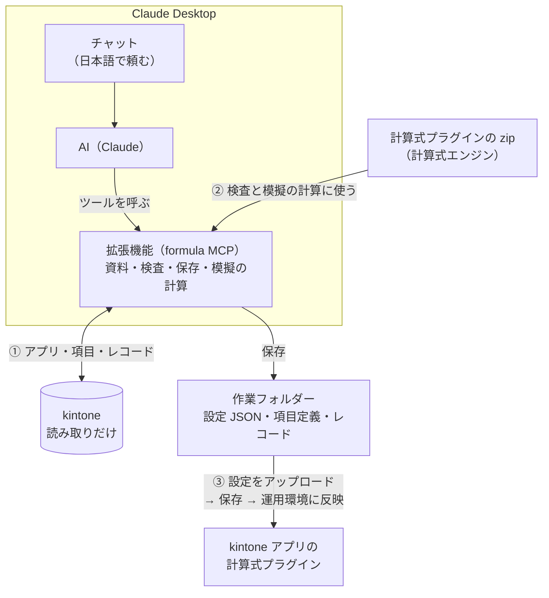

<!--
title: rex0220 計算式プラグイン - AI(Claude Desktop)にチャットで計算式を作らせる
tags:
  - kintone
  - Claude
  - MCP
private: false
url: （未公開。Qiita に貼るときは、この 2 つのコメントを除く）
-->

<!--
公開の前に確かめること（このコメントは Qiita に貼らない）:
- Claude Desktop（macOS）で、本記事の「作らせる」を通す: 疎通確認 → 出張管理（テスト用アプリ）の新規の設定 → fml_calc の表 → 設定画面で取り込み → 既存レコードを変更 → 値が表と同じか。今までに確かめたのは、Claude Code のプラグインでの同じ流れ（新規・変更・実機の取り込み）と、Desktop の拡張機能の疎通確認（0.2.3）・Cowork での式の試し計算と解説（0.2.4〜0.3.0）
- 「本記事の手順は … で確かめました」の文を、確かめた OS と拡張機能の版に書き換える
- 画像: 拡張機能のインストールの画面、拡張機能の設定（3 項目）、チャットの返答（仕様の確認の表、calc の表）、設定のアップロードの取り込み方、取り込んだ後の画面。サブドメイン・サイドバー・トークンが写っていないか（ぼかしでなく塗りつぶす）
- 「AI の返答」を、Desktop での実際の返答の抜粋に差し替える
- Windows の Claude Desktop で確かめたら、「前提」と「つまずいたら」を直す
- 本記事を公開したら、本記事の URL を計算式プラグインの本記事（ae83c6d5ce50ff7a9a73）からも案内する
- 冒頭の 3 枚（頼む・表で確かめる・取り込む）を、Desktop の実際の画面にする
- 「AI が間違えたとき」に、Desktop での実際の失敗と直しの例（検査のエラー → AI が直して保存、テストデータに無い条件を指摘して作り直し など）を 1 つ載せる
- 2026-10-18 に ChatGPT の評価（92 点）を受けて、冒頭の 3 段、手で作る場合との違い、検査と正しさの区別、本番への取り込みの注意を足した。2 回目（95 点）を受けて、比較表の確かめる時点、読み取りの API の書き方（実装は GET だけ = kintone-rest.ts）、設定を戻しても値は戻らないことを直した
-->

kintone の計算式プラグインの設定を、**Claude Desktop のチャットで頼んで** AI に作らせる拡張機能「計算式 設定オーサリング（Formula）」を公開しました。初回の準備（拡張機能を入れ、kintone の接続のファイルを書く）を済ませれば、計算式の作成も修正も、既存の計算式の解説も、チャットで頼めます。

```
計算式プラグインで、アプリ 4328 の旅費明細を分類ごとに集計したい。
分類集計のテーブルに分類と分類金額、合計金額に旅費の合計を出して。
```

これだけで、AI が**アプリの項目定義とレコードの形を確かめ、あいまいな点を表にして確かめてから**計算式を組み、検査を通した設定 JSON を作業フォルダーに保存します。続けて、取得したレコードに設定を当てた**模擬の計算**で、項目ごとの計算前と計算後の値を表にして見せます。値を確かめたら、計算式プラグインの設定画面でアップロードして保存するだけです。

流れは 3 段です。

1. **チャットで頼む** — 何をどの項目に出したいかを日本語で伝える。あいまいな点は AI が表にして聞いてくる
2. **表で確かめる** — AI が保存した設定を、取得したレコードに当てて計算し、項目ごとの計算前と計算後の値を表にする
3. **設定画面で取り込む** — 作業フォルダーの設定のファイルを、計算式プラグインの設定画面でアップロードして保存する

<!-- 画像 1: チャットで頼む -->
<!-- 画像 2: 計算の結果の表 -->
<!-- 画像 3: 設定のアップロード -->

**拡張機能（GitHub）**: https://github.com/rex0220/formula-authoring-mcp

> プラグイン本体の機能と関数の一覧は **[製品紹介記事](https://qiita.com/rex0220/items/ae83c6d5ce50ff7a9a73)** を参照してください。本記事は Claude Desktop のチャットで設定を作る方法に絞ります。
>
> - Claude Code（ターミナル）でも、本記事と同じ道具をプラグインとして入れられます（`/plugin install formula --marketplace rex0220/formula-authoring-mcp`。Claude Code 2.1.275 以降）。作業フォルダーは [formula-authoring](https://github.com/rex0220/formula-authoring) のテンプレートから作るのがおすすめです（資料と守りの設定がそろいます）
> - プラグインを入れずに、テンプレートの CLI（`npx @rex0220/formula-authoring-tools`）で同じことをする方法は、テンプレートの README にあります

---

# 仕組み

計算式プラグイン Ver.101 の設定は、設定画面の**設定のダウンロード / アップロード**で、JSON のファイルとしてまるごと受け渡しできます。拡張機能（formula MCP）は、AI がこの JSON を書くための道具と資料を、Claude Desktop に足すものです。



ポイントは 3 つです。

- **①** AI は拡張機能のツールで、アプリの項目コードと型、選択肢、テーブルの子項目、レコードの**形**（テーブルの行数など）を確かめてから計算式を組み、**要件の言葉と項目コードの対応**を示します。kintone には読み取りしか送りません
- **②** 保存の前に、**手元の計算式プラグインの zip の計算式エンジン**で、設定画面と同じ手順の検査をします。エラーが残る設定は保存されません。保存した設定は、取得したレコードに当てて**設定画面の「既存レコードを変更」と同じ 3 段の計算**（テーブルの外 → テーブルの行 → テーブルの外をもう一度）で計算し、項目ごとの前後の値を返します（kintone のレコードは更新しません）
- **③** できた設定は作業フォルダーにファイルとして残るので、設定画面でアップロードするだけです。**保存しても既存のレコードの値は変わりません**（必要なら、設定画面の「既存レコードを変更」か一覧の「一括計算」を実行します）

## 手で作る場合との違い

| 作業 | 設定画面で手で作る | チャットで AI に作らせる |
| :--- | :--- | :--- |
| 項目コードを調べる | フォームの設定で 1 つずつ見る | AI が項目定義を取り、要件の言葉との対応を示す |
| 関数と書き方を選ぶ | 関数一覧や記事を読んで選ぶ | AI が資料（関数一覧・計算パターン集）から選び、迷う書き方はサンプルアプリで実際に計算して確かめる |
| 決め切れていない点 | 書きながら気づく | 書く前に、AI が表にして聞いてくる（該当なしの行、並び順、未選択） |
| 結果を確かめる | 設定画面で保存してレコードを開き、1 件ずつ見る | 作業フォルダーに保存した後、kintone に取り込む前に、取得した複数のレコードの計算前と計算後の値を表で見る |
| 直す | 計算式を書き直して、もう一度確かめる | 「〇〇は△△にして」と頼む。AI が直して、もう一度計算する |

仕様を決めることと、最後に実機で確かめることは、どちらの場合も人が行います。

---

# 前提

| 項目 | 本記事の前提 |
| :--- | :--- |
| プラグイン | 計算式プラグイン **Ver.101 以降**（設定のアップロードで取り込み方を選べる版）。アプリに入れたものと同じ版の **zip ファイルを手元に置く** |
| Claude Desktop | **[Claude Desktop](https://claude.com/download)**（Claude のサブスクリプション）。macOS / Windows。拡張機能を動かすための Node.js などを、別に入れる必要はありません |
| 拡張機能 | 計算式 設定オーサリング（Formula）（`.mcpb` ファイル。0.3.1 以降） |
| kintone | 対象アプリの**レコード閲覧だけの API トークン**（おすすめ）。またはログイン名とパスワード（**2 要素認証なし**のアカウント） |
| 対象アプリ | 記事の例は出張管理アプリ（アプリ番号 4328）。テーブル「旅費明細」（日付、旅費分類（鉄道・バス・飛行機・タクシー・宿泊費・その他）、金額、備考）と、テーブル「分類集計」（分類、分類金額）、合計金額がある。本番のアプリでなく、**テスト用アプリとテストデータで作る**のがおすすめです（「事前準備」） |

<!-- TODO: 本記事の手順は、macOS の Claude Desktop と、拡張機能 0.3.1 で確かめました。 -->

> AI（Claude）が読んだ項目定義と設定は、Claude の処理に使われます。レコードは取るときは**形**だけを AI に返しますが、**模擬の計算の結果には、計算した項目の前後の値が入ります**（後述の「AI に渡るもの・渡らないもの」）。

---

# 準備（初回だけ）

## 1. 拡張機能を入れる

[GitHub のリリース](https://github.com/rex0220/formula-authoring-mcp/releases/latest) から拡張機能のファイル `formula-authoring-<版>.mcpb`（0.3.1 なら `formula-authoring-0.3.1.mcpb`）をダウンロードして、ダブルクリックします。インストールの画面が出たら、**インストール** を選びます。

ダブルクリックで Claude Desktop が開かないときは、Claude Desktop の **設定 → 拡張機能** の画面に、ファイルをドラッグして入れます。

<!-- 画像: 拡張機能のインストールの画面 -->

インストールの画面には、「コンピュータ上のすべてのデータへのアクセス権が付与されます」「開発者情報は Anthropic によって検証されていません」という注意が出ます。拡張機能は PC の上でプログラムとして動くので、ファイルから入れる拡張機能には Claude Desktop がこの注意を出します。この拡張機能が読むのは設定で選んだ作業フォルダー・zip・接続のファイルで、書き込むのは作業フォルダーの中だけです（kintone には読み取りしか送りません）。拡張機能のファイルは、配布元（GitHub の rex0220/formula-authoring-mcp のリリース）から入手したものだけを入れてください。

## 2. 作業フォルダーを決める

設定や項目定義を置くフォルダーを 1 つ決めます。無ければ拡張機能が作ります（最後の 1 段だけ）。

おすすめは、[formula-authoring](https://github.com/rex0220/formula-authoring) のテンプレートから作ったフォルダーです（GitHub の **Use this template** で自分のリポジトリを作って clone するか、zip でダウンロードして展開）。副作用のある関数の承認（`policy/authoring-policy.json`。後述の「ボタンを確かめる」）と、Claude Code や CLI で使うときの資料・守りの設定がそろいます。空のフォルダーでも動きます（Desktop の AI は、拡張機能に入っている資料を読みます）。

作業フォルダーには、設定と項目定義のほかに、**模擬の計算に使うレコード（値が入ります）**も保存されます。人と共有するフォルダーではなく、自分だけが使うフォルダーを選んでください。

## 3. kintone の接続のファイルを書く

kintone の接続先と認証は、**接続のファイル**（JSON）に書きます。**作業フォルダーの外**に置きます（例: ホームフォルダーの `formula-kintone.json`）。

### API トークンで使う（おすすめ）

対象アプリの API トークンを作ります。

1. アプリの設定 →「設定」タブ →「カスタマイズ/サービス連携」の **API トークン**
2. **生成する** を押し、アクセス権は **レコード閲覧** だけに印を付ける
3. **保存** → **アプリを更新**

```json
{
  "defaultProfile": "dev",
  "profiles": {
    "dev": {
      "baseUrl": "https://<自分の環境>.cybozu.com",
      "tokenMap": { "APP4328": "<アプリ 4328 の API トークン>" }
    }
  }
}
```

- `tokenMap` には、アプリごとにトークンを書きます（`APP` + アプリ番号）。アプリを足すときは、`"APP4329": "…"` のように足します
- アプリの今の計算式の設定を kintone から取るツール（`fml_pull`）は、kintone の API ラボの機能（「アプリに追加されているプラグインの設定情報を取得する」）を cybozu.com 共通管理者が有効にしているときだけ使えます（運用中の設定はレコード閲覧のトークンで取れます）。使えないときは、設定画面の **設定をダウンロード** で落としたファイルを使います（「作った後」）

### ログイン名とパスワードで使う

```json
{
  "defaultProfile": "dev",
  "profiles": {
    "dev": {
      "baseUrl": "https://<自分の環境>.cybozu.com",
      "auth": "userpass",
      "username": "<ログイン名>",
      "password": "<パスワード>"
    }
  }
}
```

- そのユーザーが見られるアプリなら、アプリごとの設定は要りません
- **2 要素認証が有効なアカウントは使えません**。パスワードが漏れると、そのアカウントで kintone にログインできてしまうので、**おすすめは閲覧だけの API トークン**です

### どちらでも

- ファイルには秘密の値が入るので、ほかの人が読めない場所（自分のユーザーのフォルダーの中）に置き、人と共有するフォルダーには置きません。Mac なら、ターミナルで `chmod 600 ~/formula-kintone.json` とすると自分だけが読めるようになります
- Claude Desktop から起動する拡張機能には、シェルの設定（`~/.zshrc` など）の環境変数は届きません。Desktop では、トークンを接続のファイルに直接書くのが確実です

> 形は kSQL（kintone の SQL ツール）の `ksql.config.json` と同じなので、kSQL のファイルをそのまま指すこともできます。ただし、書き込みにも使うトークンは共有せず、計算式用にはレコード閲覧だけのトークンを使ってください。

## 4. 拡張機能を設定する

Claude Desktop の **設定 → 拡張機能 → 計算式 設定オーサリング（Formula）** で、3 つを選びます。

| 設定項目 | 選ぶもの |
| :--- | :--- |
| 作業フォルダー | 手順 2 のフォルダー |
| 計算式プラグインの zip | アプリに入れたものと同じ版（Ver.101 以降）の zip |
| kintone の接続のファイル | 手順 3 のファイル（任意。無ければ kintone を使うツールだけが使えません） |

<!-- 画像: 拡張機能の設定 — 作業フォルダー・zip・接続のファイルを選ぶ -->

選んだら、**Claude Desktop を終了して起動し直します**（設定を変えたときも同じです）。

## 5. 疎通確認

新しいチャットで頼みます。

```
計算式プラグインの準備ができているか確かめて
```

AI が拡張機能のツールを呼び、拡張機能の版、計算式プラグインの zip の版、作業フォルダー、kintone の接続先（profile）を返して「準備ができている」と言えば、完了です。

ツールを初めて使うときは、使ってよいかの確認が出ます（Claude Desktop の決まりです）。内容を見て **常に許可** を選ぶと、次から聞かれません。

---

# 作らせる

## 事前準備（手作業）

拡張機能は kintone を変更しないので、次は人が済ませておきます。

- **テスト用アプリとテストデータを用意する（おすすめ）**: 本番のアプリを「アプリの再利用」で複製してテスト用アプリを作り（フィールドコードが本番と同じになります）、計算の確かめに要るレコードを架空の値で数件作ります。**典型でない値**（選択肢の未選択、空の金額、同じ分類の重複、明細が 0 行）を含めると、AI がその扱いも確かめます。接続のファイルにも、テスト用アプリの API トークンを書きます
- 対象アプリ（テスト用アプリ）に計算式プラグイン（Ver.101 以降）を追加する
- 計算式を置く項目（記事の例では「分類集計」の分類・分類金額と、合計金額）をアプリに作っておく

テスト用アプリとテストデータで作ると、AI に渡る値も、作業フォルダーに残る値も、架空のものだけになります。確かめた設定は、最後に本番のアプリへ取り込みます。

## 頼む

冒頭のように、チャットで頼みます。コツは 3 つです。

- **「計算式プラグインで」と付けて**頼む。拡張機能のツールを使ってほしい、という合図になります
- **アプリは番号か URL で**伝える（アプリの URL の `/k/番号/` の数字）。同じ名前のアプリの取り違えを防ぎます
- **何をどの項目に出すか**を伝える。細かい決まり（該当の無い分類を出すか、並び順、未選択の扱い）は、AI が表にして聞いてきます

AI は、おおむねこう動きます（ツールの呼び出しは自動です）。

1. 手順の資料を読み、準備ができているかを確かめる
2. アプリの項目定義を取る（作業フォルダーに `kintone/dev/4328-出張管理/` のような、アプリのフォルダーができます）。要件の言葉と項目コードの対応を示す
3. 代表のレコードを選んで取る（AI に返るのは形だけ）
4. **仕様の確認**: 計算式を書く前に、あいまいな点を表にして聞く
5. 計算式を書き、検査を通して保存する
6. 取得したレコードに設定を当てて計算し、項目ごとの前後の値を表にする
7. 設定画面での反映のしかたを伝える

## 仕様の確認に答える

出張管理の例では、AI はたとえば次のような点を聞いてきます。

| 確かめること | 選び方の例 |
| :--- | :--- |
| 該当の無い分類の行を出すか | 6 分類を固定の 6 行で出し、無い分類は 0 / 明細にある分類だけ出す |
| 行の順 | 分類の定義順 / 分類金額の大きい順 |
| 旅費分類が未選択の明細 | 集計しない / 「その他」に入れる |

答えに合わせて、AI がやり方を選びます。たとえば「6 分類を固定の行で、無い分類は 0」なら、次のような計算式になります（分類集計の行数を 6 に固定し、行ごとに分類の名前と、その分類の金額の合計を入れる）。

| 項目 | 計算式 |
| :--- | :--- |
| 分類集計（テーブル自身） | `"6"`（行数の指定） |
| 分類 | `ARRAY_GET(ARRAY("鉄道","バス","飛行機","タクシー","宿泊費","その他"), ROWNO(分類集計))` |
| 分類金額 | `LET(c, 分類, NVL(SUMIF(旅費分類 = c, 金額), 0))` |
| 合計金額 | `SUM(金額)` |

「明細にある分類だけ」なら、`TDS`（テーブルの値を重複なしの配列にする）や `TLTABLE`（テーブルの集計）を使う形になります。どちらが合うかを、AI が結果の違いを添えて聞いてきます。

## AI の返答 — 模擬の計算の表

保存が終わると、AI は取得したレコードに設定を当てた結果を表にします。たとえば、旅費明細が「鉄道 14,000 × 2、タクシー 1,800、宿泊費 9,800、バス 230」のレコードなら:

| 分類 | 分類金額 |
| :--- | ---: |
| 鉄道 | 28,000 |
| バス | 230 |
| 飛行機 | 0 |
| タクシー | 1,800 |
| 宿泊費 | 9,800 |
| その他 | 0 |
| **合計金額** | **39,830** |

<!-- TODO: Desktop での実際の返答の抜粋に差し替える（検査の警告の伝え方、反映の 4 段、「既存のレコードは変わっていません」の締め） -->

- 表は**模擬**です。kintone のレコードは更新していません
- 検査の警告（テーブル自身の計算式は行数の制御になる、テーブルの集計関数を使っている、など）は、AI が「意図したものか」を添えて伝えます。警告は保存を止めません
- 値が要件と違えば、そのまま「〇〇は△△にして」と頼みます。AI が直して、もう一度計算します
- 検査でエラーになったとき（無い関数、ラベルで書いた項目など）は、AI がエラーの規則名と場所を見て直し、検査し直します。エラーが残る設定は保存されません

**検査が通った（エラー 0）は、設定の形と計算式の書き方が計算式プラグインに合っている、という意味です。** 業務として正しいか（端数、空のときの値、対象の行、イベントごとの動き）は、表の値で人が確かめます。模擬の計算は「既存レコードを変更」と同じ 3 段の計算で、画面で値を入れたときのイベントの処理（値変更の順など）の完全な再現ではありません。ルックアップやログインユーザーのような kintone の文脈が要る式、ボタン、テーブルの行数を変える式は、テスト用アプリでも動きを確かめてください。

## 取り込む

1. アプリの設定 → プラグイン → 計算式プラグインの **設定**
2. **設定をアップロード** で、作業フォルダーの設定のファイルを選ぶ（例 `kintone/dev/4328-出張管理/APP4328-出張管理.json`。場所は AI の返答に出ています）
3. **取り込み方**を選ぶ
   - 計算式の設定がまだ無いアプリ → **全置換**
   - 既にある設定に項目を足す・差し替える → **項目の置換**（取り込む項目にチェック）。各種設定などの**共通の設定**を変えていなければ、「共通の設定」のチェックを外します
4. **保存する**（「運用環境に反映」にチェックすると、アプリの更新まで行います）
5. 以後に追加・編集するレコードは、新しい設定で計算されます。**既存のレコードは変わらない**ので、必要なら設定画面の **既存レコードを変更** か、一覧の **一括計算** を実行します

<!-- 画像: 設定のアップロード — 取り込み方を選ぶ -->

今のアプリに無い項目は、確認画面に出して取り込みません。

### 本番のアプリに取り込む

テスト用アプリで確かめた**同じ設定のファイル**を、本番のアプリの計算式プラグインの設定画面で **設定をアップロード** します。

- テスト用アプリを本番の「アプリの再利用」で作っていれば、項目（フィールドコード、型、選択肢）は同じなので、同じ計算式が動きます。テスト用アプリを作った後に本番の項目を変えたときは、本番の項目定義でもう一度作らせるか、違いを確かめてから取り込みます。今のアプリに無い項目は、取り込みの確認画面に出て取り込まれません
- 取り込む前に、本番の設定画面の **設定をダウンロード** で今の設定を保存しておくと、問題があったときに **全置換** で計算式の設定を戻せます（戻るのは設定だけで、その間に計算されたレコードの値は戻りません）
- 一覧別の設定（一覧の ID）はアプリごとに違うので、本番に取り込んだ後、本番の設定画面で一覧を選び直します
- **既存レコードを変更** と **一括計算** は、kintone のレコードを更新します（元に戻せません）。テスト用アプリで結果を確かめてから、本番では必要なときだけ実行します

---

# 作った後 — 変更・解説・確かめもチャットで頼む

## 変更する

2 回目からは、「**どのアプリ・どの項目か + 変更内容**」の形で頼みます。

```
計算式プラグインで、アプリ 4328 の分類集計の行を、分類の名前順でなく分類金額の大きい順にして
```

AI は、アプリの今の設定を取り（`fml_pull`。取れないときは、設定画面の **設定をダウンロード** で落としたファイルを作業フォルダーの `inbox/` に置くよう頼んできます）、写し（`…-edit.json`）を作って、変える項目だけを差し替えます。ダウンロードしたファイルは書き換えません。

- 変えた後に模擬の計算と、変更前との差を見せます
- 取り込みは **項目の置換** で、変えた項目だけにチェックします

## 計算式を解説してもらう

AI が作った計算式も、設定画面からダウンロードした既存の設定の計算式も、解説を頼めます。

```
計算式プラグインで、アプリ 4328 の分類金額の計算式を解説して
```

何をどの順に計算するか（テーブルの行ごとか、計算の順）、空や未選択のときの値、注意する点を、資料（関数一覧・計算パターン集）に沿って説明します。

## 関数の使い方を聞く・式を試す

```
計算式プラグインの DIC 関数について解説して
```

関数の解説と使用例は、拡張機能に入っている資料（関数一覧、計算パターン集）で答えます。資料に無い値や端の動き（空、範囲の外、0 から数えるか）を確かめたいときは、「実際に計算して確かめて」と頼むと、拡張機能に**同梱のサンプルアプリ（架空の項目とレコード）**で、実際の計算式エンジンに計算させて確かめます（利用者のアプリ・レコード・kintone は使いません）。

## ボタン（BUTTON / DIALOG）を確かめる

ボタンを押したときに項目をセットする計算式（`BUTTON` / `DIALOG` と `FSET` / `FSET_TADD`）は、押したときの動きも模擬で確かめられます。AI は「押すと どの項目が 何になるか」を表にして示します（たとえば `DIALOG(ARRAY("クリア", "旅費明細の行をすべて消します", "warning"), FSET(旅費明細, "0"))` なら、旅費明細が 0 行になり、押した後の再計算で分類金額と合計金額が 0 になる）。ボタンは、ヘッダーかスペース項目（要素 ID を付けたもの）に置きます。分類集計のように**自分の計算式で行を作るテーブルは、空にしても再計算ですぐ戻る**ので、空にするのは人が入力するテーブルです。

- ボタンの式は、レコードや画面を変える**副作用のある関数**です。拡張機能は、作業フォルダーの `policy/authoring-policy.json` で承認した関数だけを評価します。テンプレートから作った作業フォルダーは `BUTTON` / `DIALOG` / `FSET` / `FSET_TADD` を承認済みです（評価は写しのレコードの上で、kintone には書きません）。空のフォルダーで始めたときは、このファイルを作ります（AI は書きません）

```json
{ "allowFunctions": ["BUTTON", "DIALOG", "FSET", "FSET_TADD"], "allowMiscChanges": false }
```

- 模擬は押した後の値だけです。ボタンの見た目・位置・ダイアログの表示は、**テスト用アプリの編集画面で実際に押して**確かめます（保存せずに閉じれば元に戻ります。本番のアプリでは押さないでください）

---

# AI に渡るもの・渡らないもの

拡張機能のツールが AI に返すものは、次のとおりです。

| データ | AI に渡るか | 扱い |
| :--- | :--- | :--- |
| 項目定義（項目名、項目コード、型、選択肢、テーブルの子項目） | **渡る** | 計算式を書くのに要るので、1 項目 1 行の要約で渡します |
| 計算式の設定（計算式、ランク、各種設定） | **渡る** | AI が書いて直す対象です |
| レコード（取るとき） | **値は渡らない** | 渡すのは形（テーブルの行数、文字数など）だけです。レコードは作業フォルダーに保存します |
| 模擬の計算の結果 | **渡る** | 計算式を当てた項目の、計算前と計算後の値です（結果を確かめるためのもの）。**テスト用アプリとテストデータで使う**ことをおすすめする理由です |
| ユーザー・組織・グループ | **件数だけ** | ユーザー情報を使う計算式（`UINFO` など）は、既定では架空のテストデータ（10 人）で計算します。実データを取るツール（`fml_users`）も件数だけを返します。ただし、実データで模擬の計算をすると、計算の結果には実データの値が入ります |
| 接続先の URL、profile の名前 | **渡る** | どの kintone に接続するかを確かめるためです |
| API トークン、パスワード、接続のファイルの置き場所 | **渡らない** | 拡張機能が接続のファイルから読んで使うだけで、AI への応答にもログにも出しません |

気を付ける点です。

- **手元には値が残ります**: 作業フォルダーのアプリのフォルダーの `records/` には、レコードの値が入ります（本人だけが読める権限で書きます）。要らなくなったら消してください
- **ツールの外の経路は守れません**: 会話にレコードの値を書いたり、スクリーンショットを貼ったりすると、その分は AI に渡ります。ファイルを扱うほかの拡張機能を同じ Claude Desktop で有効にしていると、その拡張機能を通して `records/` の中身や接続のファイルが渡りえます
- AI に渡ったデータの扱いは、Anthropic のポリシーとお使いのプランの設定に従います。拡張機能そのものは、作者や第三者のサーバーにデータを送りません（[プライバシーポリシー](https://github.com/rex0220/formula-authoring-mcp/blob/main/PRIVACY.md)）

---

# 安全のしくみ

- **kintone は読み取りだけ**: 拡張機能が kintone に送るのは、読み取りの API（アプリの情報、項目定義、レイアウト、一覧、レコード、計算式プラグインの設定、ユーザー情報）の GET の要求だけです。レコードや設定を変える API は呼びません。設定の反映と既存レコードの再計算は、人が設定画面で行います
- **書くのは作業フォルダーの中だけ**: 保存するのは検査を通した設定だけで、同じ名前のファイルは上書きしません（直すときは、読んだ後に変わっていないかを確かめてから差し替えます）。設定画面からダウンロードしたファイルは書き換えません
- **秘密の値は出さない**: API トークンやパスワードは、AI への応答にもログにも出しません
- **計算は手元で、時間の上限つき**: 検査と模擬の計算は、手元の計算式プラグインの zip の計算式エンジンで、呼び出しごとに別の作業単位（Worker）で動かし、既定 60 秒で止めます。副作用のある関数は、作業フォルダーの policy で承認したものだけを評価し、評価の中でクリップボードや kintone の API が呼ばれた結果は採りません
- **文脈が足りなければ止まる**: ログインユーザー、ルックアップ先、接続先のような kintone の文脈が要る計算式は、文脈が無いときに推し量らず、名指しで止まります
- **zip の確認**: 拡張機能は、zip のプラグイン ID と版を確かめてから zip のコードを使います。署名までは確かめないので、zip は配布元から入手したものだけを使ってください

サーバー側からも書き込みを防ぐため、**レコード閲覧だけの API トークン**を使ってください。脆弱性の報告の窓口と受け入れた危険は [SECURITY.md](https://github.com/rex0220/formula-authoring-mcp/blob/main/SECURITY.md) に書いています。

---

# つまずいたら

| 症状 | 確認すること |
| :--- | :--- |
| AI が「準備ができていない」と言う | 拡張機能の設定の 3 項目（作業フォルダー・zip・接続のファイル）。設定を変えたら **Claude Desktop を終了して起動し直す** |
| 計算式プラグインの zip のエラー | 拡張機能の設定の zip が、アプリに入れたものと同じ版（Ver.101 以降）の計算式プラグインの zip か |
| AI が拡張機能を使わずに答える | **「計算式プラグインで」と付けて**頼む。新しいチャットで頼み直す |
| kintone の情報が取れない | 接続のファイルの `baseUrl`、`tokenMap` のアプリ番号（`APP4328` の形）、トークンのアクセス権（レコード閲覧）、トークンを作った後に **アプリを更新** したか |
| ボタンの式が「副作用のある関数」のエラーで計算されない | 作業フォルダーの `policy/authoring-policy.json` に、その関数（`BUTTON` / `DIALOG` / `FSET` / `FSET_TADD`）があるか（「ボタンを確かめる」） |
| Cowork で、同じ名前のツールが 2 組ある | Claude Code の `formula` プラグインも入れていると、Cowork には両方が見えます。Cowork では拡張機能（`.mcpb`）の方を使います（プラグインの方は、登録した作業フォルダーの外なので断ります） |
| 取り込んだのに既存のレコードの値が変わらない | 保存しても既存のレコードは変わりません。設定画面の **既存レコードを変更** か、一覧の **一括計算** を実行します |

---

# まとめ

- **チャットで頼み、表で値を確かめ、設定画面で取り込む。** AI はアプリの項目とレコードの形を確かめ、あいまいな点を聞いてから計算式を書き、拡張機能が設定画面と同じ検査と模擬の計算をします
- kintone には読み取りだけ。既存のレコードを変えるのは、設定画面の「既存レコードを変更」か一覧の「一括計算」で、人が行います
- 拡張機能: https://github.com/rex0220/formula-authoring-mcp（[最新のリリース](https://github.com/rex0220/formula-authoring-mcp/releases/latest)）
- テンプレート（作業フォルダー、CLI）: https://github.com/rex0220/formula-authoring
- プラグインの機能と関数の一覧: [rex0220 計算式プラグイン](https://qiita.com/rex0220/items/ae83c6d5ce50ff7a9a73)
